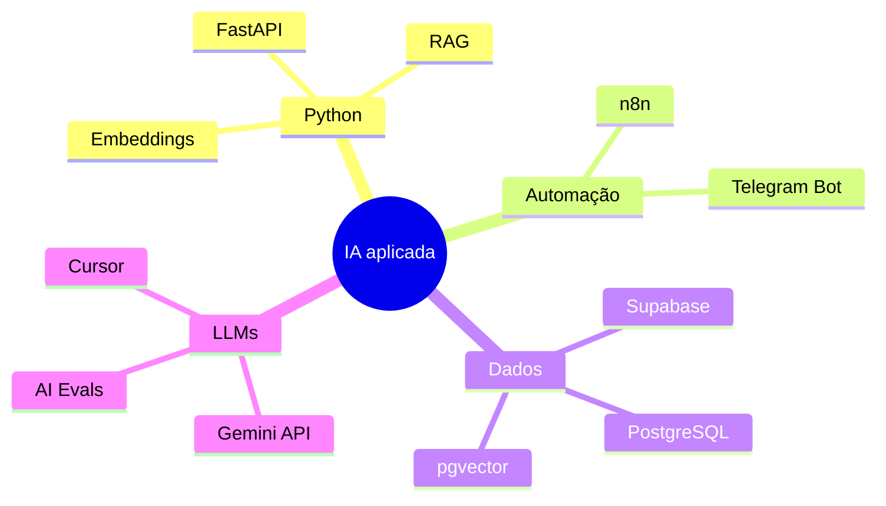

<div align="center">

  

  <a href="https://git.io/typing-svg">
    
  </a>

  <p>
    <em>Automação, dados e integração de IA na prática.</em>
  </p>

  <p>
    
  </p>

  <p>
    <a href="https://www.linkedin.com/in/catharina-napoleao-725709202/" target="_blank">
      
    </a>
    <a href="mailto:catharinannapoleao@gmail.com">
      
    </a>
  </p>

</div>


<div align="center">

  <br>

  <h3>Olá, eu sou Catharina Napoleão 👋</h3>

  <p>
    Graduanda em <strong>Ciência da Computação (IFB)</strong> e formada em <strong>Análise e Desenvolvimento de Sistemas (IESB)</strong>, <br>
    trabalho com <strong>Python</strong>, <strong>automação em n8n</strong>, <strong>Supabase</strong> e <strong>integração de LLMs</strong>.
  </p>

  <p>
    Meu foco é <strong>Engenharia de IA aplicada</strong>: RAG, agentes, assistentes por voz <br>
    e <strong>validação automatizada de IA (AI Evals)</strong>, <br>
    para criar produtos mais inteligentes e confiáveis.
  </p>

  <br>

  <p>
    
    
    
    
  </p>

</div>


<div align="center">
  <p><em>Meu cartão de visita, em Python.</em></p>
</div>

```python
class Catharina:
    nome = "Catharina Napoleão"
    formacao = ["Ciência da Computação (IFB)", "ADS (IESB)"]
    stack = ["Python", "FastAPI", "n8n", "Supabase", "LLMs"]
    foco = "Engenharia de IA aplicada"

    def aberta_a(self):
        return [
            "IA aplicada",
            "Python",
            "Automação com n8n",
            "Dados com Supabase",
        ]

    def contato(self):
        return "catharinannapoleao@gmail.com"
```


<div align="center">

  <br>

  

  <br><br>

  
  
  
  
  

  <p><em>Como as peças se conectam:</em></p>

</div>




<br><br>

<table>
<tr>
<td colspan="2" align="center" valign="top">
<h3>✦ Radar Estudos IFB</h3>
<p><strong>Python · FastAPI · RAG · n8n</strong></p>
<p>Assistente acadêmico que lê planos de ensino em PDF, extrai datas e prazos e indexa o conteúdo em banco vetorial.</p>
<p>Tutor por disciplina com RAG para consultar critérios de avaliação e conteúdos, integrado a n8n e Telegram Bot.</p>
<p>


</p>
<!-- Quando tiver um print, salve em assets/radar-estudos.png no repositório e descomente:

-->
<br>
<a href="https://github.com/ca-th/Agente-Estudos" target="_blank">

</a>
</td>
</tr>
<tr>
