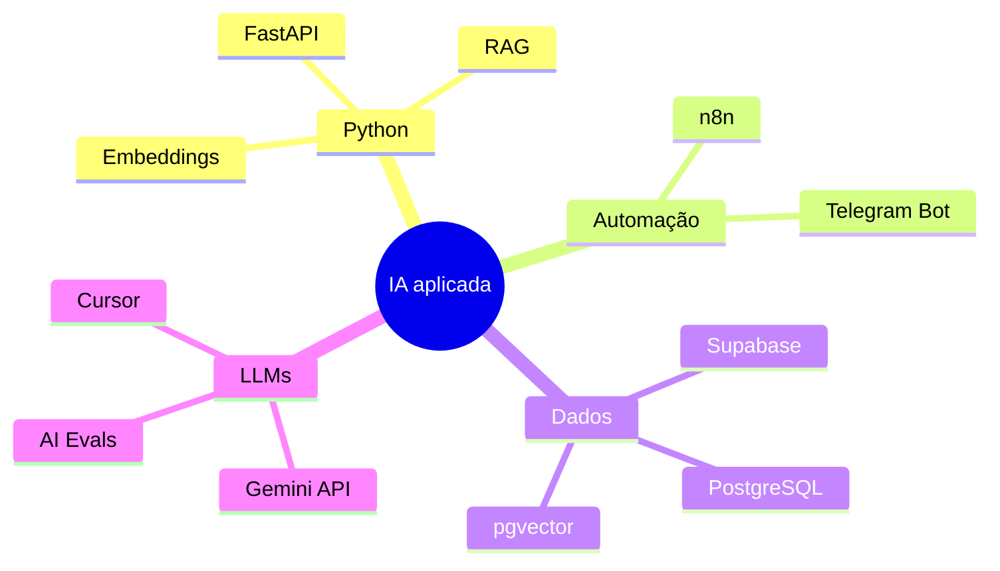
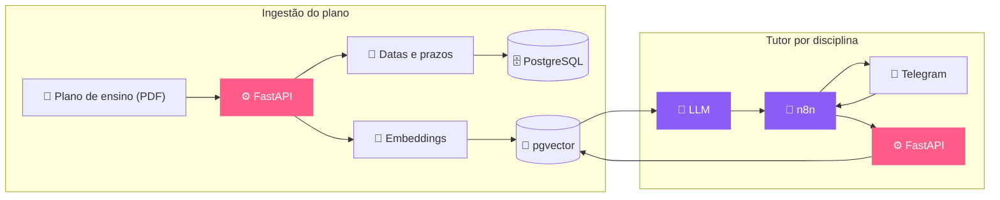

<div align="center">

  

  <br>

  <a href="https://git.io/typing-svg">
    
  </a>

  <p>
    <em>Automação, dados e integração de IA na prática.</em>
  </p>

  <p>
    
  </p>

  <p>
    <a href="https://www.linkedin.com/in/catharina-napoleao-725709202/" target="_blank">
      
    </a>
    &nbsp;
    <a href="mailto:catharinannapoleao@gmail.com">
      
    </a>
  </p>

</div>

<br>


<br>


<div align="center">

  <h3>Olá, eu sou Catharina Napoleão 👋</h3>

  <p>
    Graduanda em <strong>Ciência da Computação (IFB)</strong> e formada em <strong>Análise e Desenvolvimento de Sistemas (IESB)</strong>,<br>
    trabalho com <strong>Python</strong>, <strong>automação em n8n</strong>, <strong>Supabase</strong> e <strong>integração de LLMs</strong>.
  </p>

  <p>
    Meu foco é <strong>Engenharia de IA aplicada</strong>: RAG, agentes, assistentes por voz<br>
    e <strong>validação automatizada de IA (AI Evals)</strong>,<br>
    para criar produtos mais inteligentes e confiáveis.
  </p>

  <br>

  <p>
    
    
    
    
  </p>

</div>

<br>


<br>


<div align="center">
  <p><em>Meu cartão de visita, em Python.</em></p>
</div>

```python
class Catharina:
    nome = "Catharina Napoleão"
    formacao = ["Ciência da Computação (IFB)", "ADS (IESB)"]
    stack = ["Python", "FastAPI", "n8n", "Supabase", "LLMs"]
    foco = "Engenharia de IA aplicada"

    def aberta_a(self):
        return [
            "IA aplicada",
            "Python",
            "Automação com n8n",
            "Dados com Supabase",
        ]

    def contato(self):
        return "catharinannapoleao@gmail.com"
```

<br>


<br>


<div align="center">

  <br>

  

  <br><br>

  <p>
    
    
    
    
    
  </p>

  <p><em>Como as peças se conectam:</em></p>

</div>



<br>


<br>


<br><br>

<table>
  <tr>
    <td colspan="2" align="center" valign="top">
      <h3>✦ Radar Estudos IFB</h3>
      <p><strong>Python · FastAPI · RAG · n8n</strong></p>
      <p>Assistente acadêmico que lê planos de ensino em PDF, extrai datas e prazos e indexa o conteúdo em banco vetorial.</p>
      <p>Tutor por disciplina com RAG para consultar critérios de avaliação e conteúdos, integrado a n8n e Telegram Bot.</p>
      <p>
        
        
        
        
        
      </p>
      <!-- Quando tiver um print, salve em assets/radar-estudos.png no repositório e descomente:
      
      -->
      <p>
        <a href="https://github.com/ca-th/Agente-Estudos" target="_blank">
          
        </a>
      </p>
    </td>
  </tr>
  <tr>
    <td width="50%" align="center" valign="top">
      <h3>✧ QualLer</h3>
      <p><strong>Angular · Supabase · Google Gemini API</strong></p>
      <p>Aplicação web de recomendação literária inteligente baseada em tropos narrativos, histórico de leitura e autores.</p>
      <p>Integração com LLM para curadoria personalizada, persistência no Supabase e grupos de discussão.</p>
      <p>
        
        
        
      </p>
      <p>
        <a href="https://qual-ler.vercel.app/" target="_blank">
          
        </a>
      </p>
    </td>
    <td width="50%" align="center" valign="top">
      <h3>✦ Cypress Automation</h3>
      <p><strong>Automação E2E · Testes de API · Padrão POM</strong></p>
      <p>Suíte de testes automatizados com abordagem híbrida (API + UI) para validar fluxos críticos de ponta a ponta.</p>
      <p>Uso de dados dinâmicos para isolar cenários, evitar conflitos de execução e garantir estabilidade na regressão.</p>
      <p>
        
        
        
      </p>
      <p>
        <a href="https://github.com/ca-th/portfolio-qa-cypres" target="_blank">
          
        </a>
      </p>
    </td>
  </tr>
  <tr>
    <td width="50%" align="center" valign="top">
      <h3>✧ PontoWeb</h3>
      <p><strong>Controle de Ponto · Front-end · Supabase</strong></p>
      <p>Aplicação web para registro e acompanhamento de jornada de trabalho com interface responsiva e intuitiva.</p>
      <p>Cálculo automatizado de horas, histórico de marcações e validação de regras de jornada em tempo real.</p>
      <p>
        
        
        
      </p>
      <p>
        <a href="https://ponto-web-ten.vercel.app/" target="_blank">
          
        </a>
      </p>
    </td>
    <td width="50%" align="center" valign="top">
      <h3>✦ Sistema de Biblioteca</h3>
      <p><strong>Banco de Dados · Regras de Negócio · Integridade</strong></p>
      <p>Sistema de gerenciamento bibliotecário com regras de negócio implementadas diretamente na camada de dados.</p>
      <p>Aplicação de Triggers e Stored Procedures com foco em consistência, rastreabilidade e validação de restrições.</p>
      <p>
        
        
        
      </p>
      <p>
        <a href="https://github.com/ca-th/Sistema-Bibliotecario-Faculdade" target="_blank">
          
        </a>
      </p>
    </td>
  </tr>
</table>

<br>


<br>


<div align="center">
  <p><em>Duas rotas: a ingestão do plano de ensino e o tutor via Telegram.</em></p>
</div>



<br>


<br>


<div align="center">

  <h3>✦ Estagiária em Desenvolvimento com IA</h3>
  <p><strong>SENAI/DF · Atual</strong></p>

  <p>
    Desenvolvimento assistido por IA (Cursor), validações no Supabase<br>
    e funcionalidades inteligentes no sistema, como <strong>interação por voz</strong><br>
    e <strong>assistente virtual de ajuda</strong>.
  </p>

</div>

<br>


<br>


<div align="center">

  <h3>✦ Vamos conversar?</h3>

  <p>
    Aberta a oportunidades e colaborações em <strong>Engenharia de IA aplicada</strong>,<br>
    <strong>Python</strong> e <strong>Automação com n8n e Supabase</strong>.
  </p>

  <p>
    <a href="mailto:catharinannapoleao@gmail.com">
      
    </a>
    &nbsp;
    <a href="https://www.linkedin.com/in/catharina-napoleao-725709202/" target="_blank">
      
    </a>
  </p>

  <br>

  

</div>
